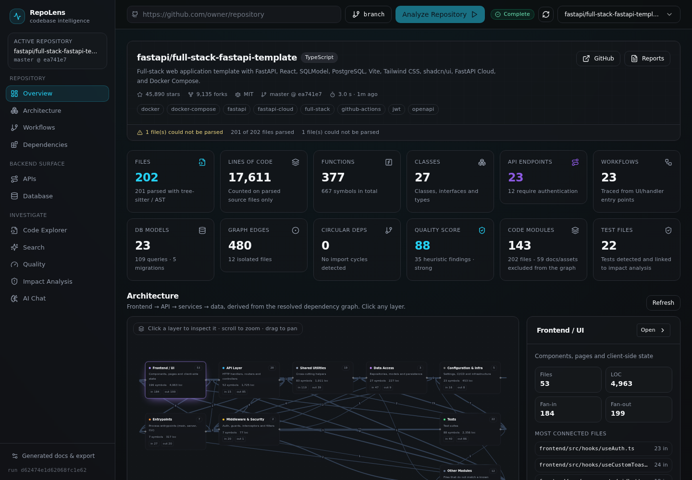

# RepoLens

**Codebase intelligence for any public GitHub repository.** Paste a GitHub URL and get a navigable model
of how the repository works: architecture layers, traced workflows, the API surface, the data model,
the dependency graph, quality signals, ranked code search, impact analysis and optional source-grounded AI chat.

RepoLens is not a GitHub viewer. It downloads the source through the GitHub API, parses every supported
file with tree-sitter (and Python's AST for `.py`), resolves imports and calls across files, builds a
graph, and detects routes, models, queries and workflows. Every number on screen comes from that parsed
evidence. Anything heuristic is labelled as such.



| Screen | What it shows |
|---|---|
| **Architecture** | Layer graph from frontend to API, services and data, with per-layer detail |
| **Workflows** | Auto-traced flows with step and sequence views |
| **Dependencies** | Module graph, cycles, hubs and isolated modules |
| **APIs** | Routes with method, handler, service, auth and provenance badges |
| **Database** | Models, fields, relations and the query inventory |
| **Code Explorer** | Source with symbols, references and jump-to-file |
| **AI Chat** | Optional RAG answers grounded in the analyzed commit, with clickable source citations |
| **Quality** | Complexity, coupling, cycles and missing tests (labelled as heuristics) |
| **Impact** | Dependents, affected endpoints and workflows, related tests and risks |
| **Reports** | README, API and onboarding drafts and a JSON export |

## How storage and sessions work

RepoLens downloads source into a per-analysis temporary directory, parses it without running repository
code, and removes the checkout when analysis ends. A startup sweep also removes checkouts left by an
ungraceful restart.

* **RAM-only analysis SQLite.** Analysis results and browser-session records live in an in-memory SQLite database and disappear when the API process stops. Neon is used only for the optional RAG chat index; it does not replace the existing analysis store.
* **Session isolation.** The server issues an opaque `HttpOnly` cookie; only its SHA-256 digest is stored. Analysis leases are bound to that session and a browser tab. Caller-supplied analysis IDs alone do not grant access.
* **User-inactivity expiry.** A visible tab heartbeats only while pointer, keyboard, touch or wheel input has occurred within the last heartbeat interval. Background polling and an open-but-idle tab never extend the lease. The server expires results after `WINDOW_TTL_SECONDS` (default 30 minutes) from the last heartbeat (normally within 20 seconds of the last input); expired runs disappear from listings immediately and the sweeper removes their rows within one cleanup interval. The client also clears its local analysis and SWR data at expiry.
* **Public repositories only.** RepoLens rejects private repositories. GitHub API access is anonymous by default (typically 60 requests per hour per originating IP). An optional server-side `GITHUB_TOKEN` authenticates public-data requests for a higher limit (typically up to 5,000 requests per hour per user); it does not enable private repositories. Never expose the token in browser code.
* **Source retention.** Full files are not stored with analysis records. Keyword search keeps deduplicated identifier terms by default; the Code Explorer fetches a selected file from GitHub on demand. When RAG is configured, RepoLens stores at most `RAG_INDEX_MAX_CHUNKS` short source excerpts and vectors per public-repository commit in Neon, keeping the latest two indexed commits. Retrieved excerpts plus the user's question and recent tab-local chat turns are sent server-side to the configured OpenAI-compatible provider. Chat history is not saved by RepoLens.
* **Optional AI.** Static analysis, keyword search and impact remain deterministic. AI chat runs only when both `RAG_DATABASE_URL` and `RAG_API_KEY` are configured; otherwise the chat page explains the setup needed and the rest of RepoLens works normally.

## Dashboard data loading

Overview, Architecture, Dependencies, APIs, Database and Workflows use keyed SWR requests. Each page asks for its own analysis artifact; a bounded 32 MiB in-tab GET cache deduplicates requests and warms the principal dashboard results after a run completes. Switching pages never starts a new analysis. Route changes keep the current page visible and use only a thin progress bar; a real data miss gets a local skeleton rather than a full-page spinner.

## Quick start (local)

Requirements: Python 3.11+ and Node.js 20+.

```bash
git clone <this repo> repolens && cd repolens

# 1. API
python -m venv .venv && source .venv/bin/activate
pip install -e packages/shared -e packages/parser -e packages/graph -e apps/api
cp .env.example .env                  # optional runtime settings; leave RAG secrets blank to keep chat disabled
cd apps/api && python -m uvicorn app.main:app --host 0.0.0.0 --port 8000

# 2. Web app (second terminal)
cd apps/web && npm install
API_INTERNAL_URL=http://127.0.0.1:8000 npm run dev      # http://localhost:3000
```

Paste `https://github.com/fastapi/full-stack-fastapi-template` into the header and press **Analyze**.

## Quick start (Docker)

```bash
cp .env.example .env          # optional runtime settings; set RAG secrets only if you want AI chat
docker compose up --build     # web on http://localhost:3000, API on http://localhost:8000
```

The stack has two services, `api` and `web`. The web server proxies `/backend/*` to the API on the
internal network, so the browser only talks to one origin. There are no host volumes; source checkouts
use container-local temporary storage and are removed after each run or on startup. Analysis and session
results live only in RAM and disappear when the API stops; optional RAG excerpts/vectors persist in Neon.
RepoLens supports public repositories only. GitHub access is anonymous by default; optionally set
`GITHUB_TOKEN` on the API service to authenticate public-data requests and raise the GitHub API rate limit.
Private repositories remain unsupported. For an HTTPS deployment, set `APP_ENV=production` (to enable
Secure session cookies) and restrict `CORS_ORIGINS` to the origins you operate.

## Deploy on Render with Neon RAG

The root `render.yaml` defines separate Render services for the API and Next.js UI. The API runs as a
single process with RAM-only analysis/session state; the web service proxies `/backend/*` to it over
Render's private network. The blueprint uses Render's free web plan by default, so services may spin down
or restart and in-memory analyses will be lost. Upgrade the API plan if you need more memory or an
always-on process.

To enable RAG after deployment, add these **only to the API service's server-side environment** in the
Render dashboard:

1. `RAG_DATABASE_URL` — the Neon PostgreSQL connection URL (use Neon SSL settings and enable `pgvector`).
2. `RAG_API_KEY` — a key for an OpenAI-compatible embeddings and chat API.
3. Optionally set `RAG_API_BASE_URL`, `RAG_CHAT_MODEL`, `RAG_EMBEDDING_MODEL` and
   `RAG_EMBEDDING_DIMENSIONS` if your provider uses different compatible models.

No secrets are needed to deploy the application; chat remains disabled until both required settings are
present. Never use `NEXT_PUBLIC_` names for these credentials. After adding them, analyze the repository
again to build the Neon index for its resolved commit. Reanalysis is safe: the RAG index is replaced for
that commit, and older entries are pruned to the latest two commits per public repository.

## Features

| Area | What you get |
|---|---|
| **Overview** | Languages, frameworks, counts, database technologies, run status, insights |
| **Architecture** | Layer graph (frontend → API → services → data) with per-layer files and connections |
| **Workflows** | Auto-traced flows from routes and UI entry points through services to data, with step and sequence views |
| **Dependencies** | Module graph, import and call edges, cycles, hubs, isolated modules |
| **APIs** | Method, path, handler, service, auth, provenance badges, Markdown export |
| **Database** | Technologies, models and fields, relations, query inventory |
| **Code Explorer** | Source viewer with symbols, references, imports and dependents |
| **Search** | Ranked search over paths, symbols and identifier terms; source snippets are opt-in |
| **AI Chat** | Optional RAG answers grounded in the indexed commit, with clickable file/line citations |
| **Quality** | Complexity, coupling, cycles, large modules, duplication, missing tests (heuristics, labelled) |
| **Impact Analysis** | Dependents, transitive reach, affected endpoints and workflows, related tests, risks |
| **Reports** | README, API and onboarding drafts built from the analysis, plus a full JSON bundle |

## How an analysis runs

```
GitHub URL ──▶ validate + metadata (GitHub API)
            ──▶ download sources to a temporary folder (deleted at the end of the run)
            ──▶ walk files (limits, ignores, binary and large-file skip)
            ──▶ parse each file      tree-sitter for 20+ languages, Python AST for .py
                                     └─ per-file failures are warnings, never fatal
            ──▶ resolve imports      internal / external / unresolved, router prefixes
            ──▶ build graph          code-module nodes, import + call edges, cycles, hubs
            ──▶ detect               frameworks, endpoints, DB models/queries, layers
            ──▶ trace workflows      from entry points through services to data
            ──▶ quality + insights   complexity, coupling, duplication, missing tests
            ──▶ index for search     symbol, file and doc identifiers (no source excerpts by default)
            ──▶ optional RAG index   capped code/doc excerpts + vectors in Neon pgvector
            ──▶ store results        analysis artifacts in RAM-only SQLite; RAG retains latest two commits
```

Every stage reports progress and can be cancelled. A run that exceeds `MAX_ANALYSIS_SECONDS` (default
30 minutes) fails with a clear message.

### Scope rules (what is *not* counted)

* **Documentation and assets stay out of the graph.** Only files that can carry dependencies become
  graph nodes. `docs/`, `.rst`, Markdown, data and image files are never counted as isolated modules or
  hubs. By default their paths are searchable without retaining body text; setting
  `STORE_SOURCE_SNIPPETS=true` keeps short excerpts in RAM, while configured RAG may persist a capped set of
  relevant documentation excerpts and vectors in Neon for repository chat.
* **Endpoints are deduplicated by `method + path`.** When the same URL is declared in several files, the
  application's own declaration wins. Other declarations are kept with an `is_example` / `is_test` flag,
  so a library repository reports "33 endpoints, all declared in example or test applications" instead
  of inventing an API surface.
* **Workflows are scoped the same way** (`application`, `example` or `test`, with a `scope_note`).
* **Large files are skipped.** Files over `MAX_FILE_BYTES` (default 1 MiB) are not parsed, because minified
  or generated files slow parsing and produce meaningless symbols. Skipped files are counted in the run summary.

### Grounding rules

* Counts, paths, line numbers, endpoints, models and workflows come from parser output.
* Detections carry `confidence` and `evidence[]`. Quality findings are marked `heuristic: true`. Traces
  flag `trace_truncated` when static resolution runs out of road.
* Impact analysis runs on the stored graph, so the numbers are the same everywhere they appear.

## Repository layout

```
repolens/
├── apps/
│   ├── api/                        FastAPI service
│   │   └── app/
│   │       ├── api/                routes: system, repos, analyses, chat, insights
│   │       ├── analyzers/          endpoints, database, insights, docs, pipeline
│   │       ├── core/               config, in-memory SQLite db, logging, errors, capabilities
│   │       ├── models/tables.py    analysis-scoped tables
│   │       └── services/           github, store, search, RAG embeddings/retrieval, analysis manager, impact
│   └── web/                        Next.js 15 + Tailwind UI
│       ├── app/                    one route per product area
│       ├── components/             UI primitives, graphs, explorer
│       └── lib/                    typed API client, hooks, types
├── packages/
│   ├── shared/                     constants, schemas, errors
│   ├── parser/                     tree-sitter and Python AST analyzers, import resolvers, framework detection
│   └── graph/                      dependency graph, layers, workflow tracer, impact, quality
├── infrastructure/docker/          api.Dockerfile, web.Dockerfile
├── docker-compose.yml              api + web
└── .env.example                    every setting, documented
```

## Configuration

Runtime settings are set through environment variables. See [`.env.example`](.env.example) for defaults.
Analysis results stay in RAM; the separate `RAG_DATABASE_URL` is used only for optional Neon pgvector chat
indexes. Repositories must be public. GitHub API access is anonymous by default (typically 60 requests/hour
per originating IP); optionally configure a server-side
`GITHUB_TOKEN` to authenticate public-data requests (typically up to 5,000 requests/hour per user). The token
never belongs in browser code and does not enable private-repository access.

| Variable | Default | Purpose |
|---|---|---|
| `APP_ENV` | `development` | Set to `production` to enable Secure session cookies |
| `LOG_LEVEL` | `INFO` | API log verbosity |
| `GITHUB_TOKEN` | unset | Optional server-side GitHub PAT for a higher API rate limit; only public repositories are accepted |
| `CORS_ORIGINS` | localhost:3000 | Allowed browser origins for direct API calls with credentials |
| `MAX_ANALYSIS_SECONDS` | `1800` | Maximum repository-download time plus cooperative analysis deadline |
| `MAX_REPO_BYTES` | `104857600` | 100 MiB cap on downloaded and expanded source (`0` disables the cap and allows clone fallback) |
| `MAX_FILES` / `MAX_FILE_BYTES` | `4000` / `1048576` | Maximum indexed text files and per-file size threshold |
| `MAX_ACTIVE_ANALYSES_PER_SESSION` | `2` | Limit concurrent jobs per browser session |
| `MAX_ANALYSES_PER_HOUR` | `20` | Limit job submissions per browser session |
| `WINDOW_TTL_SECONDS` / `WINDOW_SWEEP_SECONDS` | `1800` / `30` | Idle lease expiry and cleanup interval |
| `SESSION_TTL_SECONDS` | `2592000` | Sliding lifetime for the HttpOnly browser session |
| `STORE_SOURCE_SNIPPETS` | `false` | Keep short keyword-search excerpts in RAM until analysis expiry |
| `RAG_DATABASE_URL` / `RAG_API_KEY` | unset | Optional server-only Neon pgvector URL and OpenAI-compatible provider key; both are required for chat |
| `RAG_API_BASE_URL` | `https://api.openai.com/v1` | OpenAI-compatible embeddings/chat endpoint base URL |
| `RAG_CHAT_MODEL` / `RAG_EMBEDDING_MODEL` | `gpt-4o-mini` / `text-embedding-3-small` | Models used for answer generation and vector embeddings |
| `RAG_EMBEDDING_DIMENSIONS` | `1536` | Embedding size; must match the configured model and provider |
| `RAG_INDEX_MAX_CHUNKS` / `RAG_CHUNK_MAX_CHARS` | `250` / `3500` | Bound stored source excerpts per commit and each excerpt's maximum length |
| `RAG_TOP_K` / `RAG_CONTEXT_MAX_CHARS` | `6` / `18000` | Retrieved excerpts and maximum context sent to chat |
| `RAG_MAX_HISTORY_MESSAGES` / `RAG_MAX_OUTPUT_TOKENS` | `8` / `800` | Per-tab chat context and answer budget |
| `RAG_CHAT_REQUESTS_PER_MINUTE` | `12` | Per-session chat request guardrail |
| `ANALYSIS_WORKERS` | `2` | Concurrent analyses per API process |
| `API_INTERNAL_URL` | `http://127.0.0.1:8000` | Server-side Next.js proxy target |
| `NEXT_PUBLIC_API_BASE` | `/backend` | Browser-facing same-origin API path |

`GET /api/system/capabilities` reports the in-memory analysis-storage mode, effective limits, and public-only GitHub policy. The chat-status endpoint reports whether optional RAG is configured for the current run; it never returns credentials. Per-session quotas are guardrails, not a full abuse-prevention system; public deployments should also apply edge/IP rate limiting and monitoring.

## Local verification

From the repository root, run `python -m unittest discover -s apps/api/tests -v` for local HTTP
lifecycle, expiry, restart, process-local concurrency, a complete fixture-repository analysis, and
bounded chunk-memory checks. From `apps/web`, run `npm run typecheck` and `npm run build` to validate
the frontend.

## API reference

While the API is running, every endpoint, with request and response shapes, is listed at
`http://localhost:8000/docs` (generated by FastAPI). `GET /api/health` reports whether the service is up.

## Limits and honesty notes

* Static analysis cannot see dynamic dispatch, dependency-injection containers, string-based routing or
  reflection. Each view says where its knowledge stops.
* Layers are derived from path conventions and resolvable edges, and are marked *heuristic*.
* Language depth: Python, TypeScript, JavaScript, Go, Java, Ruby, PHP, Rust, C#, C/C++, and Vue/Svelte are
  parsed into symbols and edges. SQL, GraphQL, Proto, YAML/JSON/TOML, Markdown, shell and Dockerfiles are
  not parsed into symbols; paths remain searchable by default, while body text is indexed only when
  `STORE_SOURCE_SNIPPETS=true`.
* Run one API process/replica. Analysis tasks and the SQLite database are process-local; their results disappear when that process stops. Neon RAG vectors persist separately, but a fresh analysis is still required to restore an expired browser session. Horizontal scaling of analysis workers is outside the current design.
* Not implemented: notifications and pull-request or branch diffing.
